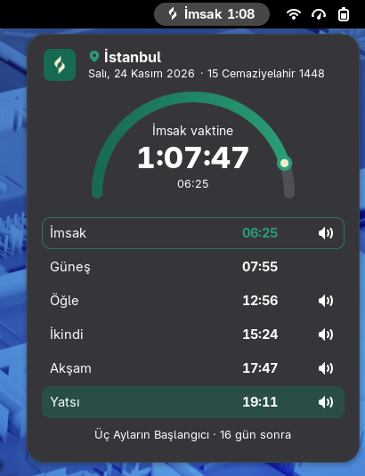
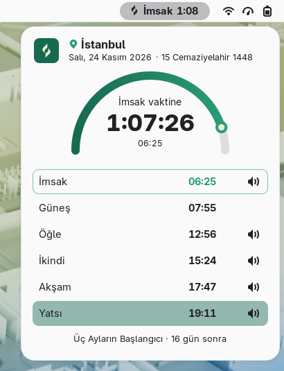
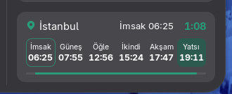
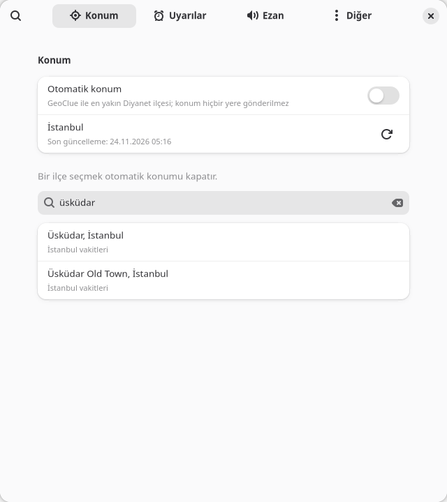
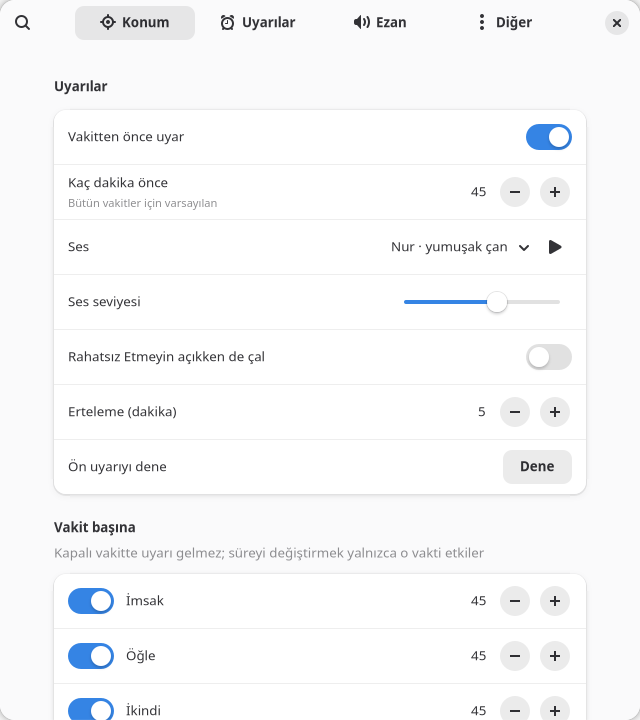
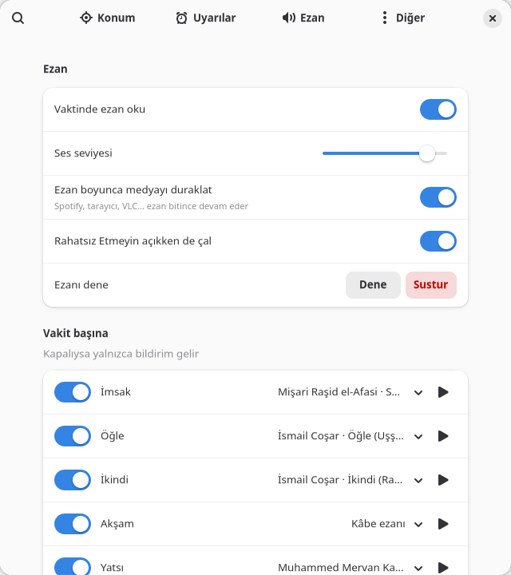

<p align="center">
  
</p>

<h1 align="center">Sakaleyn</h1>

<p align="center">
  <b>Linux için ezan vakti uygulaması</b><br>
  Diyanet vakitleri · vakitten önce uyarı · vaktinde ezan · otomatik konum
</p>

<p align="center">
  <a href="https://github.com/ensignalp/sakaleyn/releases/latest"></a>
  
  
  <a href="LICENSE"></a>
</p>

<p align="center">
  
  
</p>

---

## Tek komutla kurulum

```sh
curl -fsSL https://raw.githubusercontent.com/ensignalp/sakaleyn/main/install.sh | sh
```

- **sudo gerekmez.** Her şey kendi kullanıcınıza kurulur (`~/.local`).
- **Her dağıtımda çalışır.** Statik ikili, kütüphane bağımlılığı yok: Fedora, Ubuntu,
  Debian, Arch, openSUSE, Mint…
- **Kurulanlar:** arka plan servisi (systemd kullanıcı servisi), ezan ve uyarı sesleri,
  simgeler, ayarlar penceresi ve GNOME'daysanız GNOME eklentisi. KDE, XFCE,
  Cinnamon ve MATE'te tepsi simgesi kurulur.
- **GNOME'da** eklentinin görünmesi için bir kez oturumu kapatıp açın (Wayland
  kısıtı). İlk açılışta GNOME konum izni sorar.

Kaldırmak:

```sh
curl -fsSL https://raw.githubusercontent.com/ensignalp/sakaleyn/main/install.sh | sh -s -- --uninstall
```

<details>
<summary>Diğer kurulum yolları ve seçenekler</summary>

**Kaynaktan** (Rust gerekir):

```sh
git clone https://github.com/ensignalp/sakaleyn.git && cd sakaleyn
make install            # make uninstall ile kaldırılır
```

Kaynaktan kurulumda ezan kayıtları gelmez; sürüm paketinden alın ya da kendi
dosyalarınızı `~/.local/share/sakaleyn/sounds/` klasörüne koyun.

**Kurulum betiğinin seçenekleri** (`… | sh -s -- <seçenek>`):

| Seçenek | Açıklama |
|---|---|
| `--uninstall` | Kaldırır (ayarlarınız kalır) |
| `--version 0.1.0` | Belirli bir sürümü kurar |
| `--prefix DİZİN` | İkiliyi `DİZİN/bin` altına kurar (varsayılan `~/.local`) |
| `--tray` | GNOME'da da tepsi simgesini oturum açılışına ekler |
| `--no-start` | Servisi başlatmaz (paketleme, test) |

**Dağıtım paketleri:** Fedora/COPR için `packaging/rpm/sakaleyn.spec`,
Debian/Ubuntu için `scripts/build-deb.sh`, Arch için `packaging/arch/PKGBUILD`.

**Gereksinimler:** ses için şunlardan biri yeterli (çoğu dağıtımda kurulu gelir):
`pw-play` (PipeWire), `paplay`, `gst-play-1.0`, `ffplay` ya da `mpv`. Otomatik konum
için `geoclue2`, ayarlar penceresi için `gjs` + `libadwaita` (GNOME'da hazır) gerekir.

</details>

## Özellikler

| | |
|---|---|
| 🕌 **Diyanet vakitleri** | İlçenin yıllık tablosu indirilir ve önbellekte tutulur; ayda bir istek yeter, internet yokken de çalışır. Diyanet'e hiç ulaşılamazsa vakitler Diyanet yöntemiyle hesaplanır ("tahmini"; Türkiye'de ±1 dk). |
| 📍 **Otomatik konum** | GeoClue ile en yakın Diyanet ilçesi bulunur. Türkiye'de 55.000'i aşkın ilçe, semt ve köy (Üsküdar, Beylerbeyi, Kadıköy…) Diyanet'in kuralıyla doğru tabloya bağlanır. Konumunuz hiçbir yere gönderilmez. Yurt dışında 200'den fazla ülkedeki 8.600 şehir. |
| 🔔 **Vakitten önce uyarı** | Varsayılan 45 dakika; 1–180 dakika arası, vakit başına ayrı süre ve aç/kapa. Bildirimde "5 dk ertele". |
| 📢 **Vaktinde ezan** | Her vakit için ayrı ezan; Cuma öğlesi için ayrı ses. Ezan boyunca çalan müzik/video (Spotify, tarayıcı, VLC) duraklatılır, bitince devam eder. Bildirimde "Sustur" ve "Kıldım". |
| 🌙 **Ramazan** | Hicri takvimden otomatik: iftar ve imsak geri sayımı, sahur uyarısı ("Esselâtü hayrun minen nevm"). |
| 🗓 **Cuma, kandil, bayram** | Cuma namazı hatırlatması; Diyanet dini günler takviminden kandil ve bayram bildirimleri. |
| ⏰ **İsteğe bağlı** | Güneş doğmadan uyarı, kerahat vakitleri, "kılınmadıysa vakit çıkıyor" hatırlatması, vakit düzeltmeleri. |
| 🛌 **Uyku güvenliği** | Uykudan uyanınca eski ezan çalmaz; kaçırılan vakit sessiz bildirimle haber verilir. Aynı ezan iki kez çalmaz. |
| 🎵 **Kendi sesiniz** | `~/.local/share/sakaleyn/sounds/` klasörüne mp3/ogg/flac koyun; ayarlarda listelenir. |
| 🌐 **Türkçe / İngilizce** | Arayüz ve bildirimler. |

## Ekran görüntüleri

<table>
  <tr>
    <td width="50%"><b>Hızlı Ayarlar:</b> tek basışla bütün bildirimleri aç/kapa<br></td>
    <td width="50%"><b>Bildirim penceresinde</b> günün vakitleri ve geri sayım<br></td>
  </tr>
  <tr>
    <td colspan="2"><b>Vakitten önce uyarı</b><br></td>
  </tr>
  <tr>
    <td colspan="2">
      <b>Ayarlar:</b> konum (semt aramasıyla), uyarılar, ezan sesleri<br>
      
      
      
    </td>
  </tr>
</table>

## Nerede görünür

- **GNOME üst paneli:** logo, sıradaki vakit ve kalan süre (`İmsak 1:08`). Vakte
  yaklaşınca renklenir. Tıklayınca açılır pencere gelir: yarım daire geri sayım,
  günün vakitleri, ezan zilleri ve "kıldım" işaretleri. Pencerenin sol üstündeki
  logo ayarları açar.
- **Hızlı Ayarlar:** "Sakaleyn" kutucuğu bütün uyarı, ezan ve bildirimleri açar/kapar.
- **Tarih ve bildirim penceresi:** günün vakitleri kartı, canlı geri sayımla.
- **KDE, XFCE, Cinnamon, MATE:** tepsi simgesi (vakitler, sustur, bugün sessiz, ayarlar).
- **Terminal:** `sakaleyn` komutu.

Sesi GNOME eklentisi değil arka plandaki servis çalar. Eklenti kapalı olsa, GNOME
yeniden başlasa ya da başka bir masaüstü kullanılsa da ezan okunur.

## Kullanım

```sh
sakaleyn today                     # bugünün vakitleri
sakaleyn next                      # sıradaki vakit ve kalan süre
sakaleyn city search üsküdar       # ilçe/semt ara (Türkçe karakter ve büyük/küçük harf fark etmez)
sakaleyn city set 9541             # ilçeyi elle seç (otomatik konum kapanır)
sakaleyn city auto                 # otomatik konuma dön
sakaleyn where                     # konumu bul, hangi ilçeye bağlandığını göster
sakaleyn settings                  # ayarlar penceresi
sakaleyn sounds                    # sesleri listele
sakaleyn test-sound ogle           # öğle ezanını dinle (Ctrl+C durdurur)
sakaleyn test-event pre_alert ogle # gerçek bir uyarıyı şimdi dene
sakaleyn stop                      # çalan sesi durdur
sakaleyn status                    # servisin durumu (JSON)
```

## Ayarlar

Ayarların hepsi ayarlar penceresinden yapılır (GNOME: eklenti tercihleri ya da
paneldeki pencerenin logosu, diğer masaüstleri: `sakaleyn settings`). Ayarlar
`~/.config/sakaleyn/config.toml` dosyasına yazılır; açıklamalı tam liste için
[`config.example.toml`](config.example.toml) dosyasına bakın.

```toml
[alerts]
minutes = 45                 # vakitten kaç dakika önce
sound = "nur"                # nur | seher | damla | hilal | uyandirma | none

[alerts.per_vakit]           # vakit başına farklı süre
imsak = 60

[adhan.sounds]               # vakit başına ezan
ogle = "cosar-ussak"
aksam = "kabe"

[friday]
minutes = 60                 # Cuma namazından önce
```

### Konum nasıl bulunur?

1. GeoClue koordinatı verir; konumunuz bilgisayarınızdan çıkmaz.
2. Türkiye'de koordinata en yakın ilçe, semt ya da köy bulunur ve Diyanet'in
   kuralıyla bir tabloya bağlanır. Kural: o ilçenin kendi tablosu varsa o tablo
   (ör. Kartal), yoksa il merkezinin tablosu (ör. Üsküdar → İstanbul). Yurt dışında
   en yakın Diyanet şehri seçilir.
3. Konum hizmeti kapalıysa ya da izin verilmediyse saat diliminizden geçici bir il
   seçilir ve bildirim gelir. Açılır penceredeki uyarıya tıklayıp ilçe ya da semt
   adıyla arayarak seçebilirsiniz.

## Sorun giderme

| Durum | Çözüm |
|---|---|
| Panelde görünmüyor | Oturumu kapatıp açın. `gnome-extensions info sakaleyn@ensignalp` ile eklentinin etkin olup olmadığına bakın. |
| Ses çalmıyor | `sakaleyn test-sound nur` çalıştırın. Hata veriyorsa bir ses oynatıcı kurun (`pipewire-utils` en kolayı). |
| Konum yanlış ya da bulunamıyor | Ayarlar → Konum'dan semt adıyla arayın ya da `sakaleyn city search <ad>` kullanın. GNOME'da Ayarlar → Gizlilik → Konum Hizmetleri açık olmalı. |
| Vakitler "tahmini" | Diyanet'e ulaşılamadı. İnternet gelince otomatik düzelir; elle yenilemek için Ayarlar → Konum → ⟳. |
| Servis çalışıyor mu? | `systemctl --user status sakaleyn`, günlük için `journalctl --user -u sakaleyn -f`. |

## Mimari

```
crates/sakaleyn-core   Diyanet ayrıştırıcı, önbellek, ilçe/semt veritabanı, yedek hesap,
                       ayarlar, olay planlayıcı (ağ dışında yan etkisiz, testli)
crates/sakaleyn        servis (zamanlayıcı, ses, bildirim, MPRIS, GeoClue, logind),
                       CLI, tepsi simgesi
gnome-extension/       GNOME Shell 48–50 eklentisi + ayarlar arayüzü (settings-ui.js)
settings-app/          aynı ayarlar arayüzünün bağımsız penceresi (GNOME dışı)
assets/                districts.json, places.json, sesler, logo
scripts/               veri ve ses üretimi, sürüm paketleri
```

Servis D-Bus'ta `io.github.ensignalp.Sakaleyn` adıyla çalışır; arayüz
[`crates/sakaleyn/src/dbus.rs`](crates/sakaleyn/src/dbus.rs) dosyasında belgelenmiştir.

### Geliştirme

```sh
cargo test                         # çekirdek ve servis testleri
cargo clippy --all-targets
make install                       # derle ve kendi kullanıcına kur
make static && make dist           # statik ikili (podman/docker) ve sürüm paketleri
```

<details>
<summary>Verileri yeniden üretmek</summary>

```sh
python3 -I scripts/fetch-districts.py scripts/data/diyanet-tree.json   # Diyanet ilçe ağacı (~30 dk)
# GeoNames: cities500.zip, TR.zip, admin1CodesASCII.txt, countryInfo.txt → <geo>
python3 -I scripts/build-districts.py scripts/data/diyanet-tree.json scripts/data/countries-en.json \
    <geo> assets/districts.json --nominatim --cache scripts/data/nominatim-cache.json
python3 -I scripts/build-places.py <geo>/TR.txt assets/districts.json assets/places.json
scripts/make-alerts.sh             # ön uyarı sesleri (sox)
scripts/prepare-sounds.sh <klasör> # ezan kayıtları (ffmpeg)
```

</details>

## Veri kaynakları ve lisanslar

- **Kod:** [MIT](LICENSE).
- **Namaz vakitleri ve dini günler:** T.C. Diyanet İşleri Başkanlığı
  (namazvakitleri.diyanet.gov.tr, vakithesaplama.diyanet.gov.tr).
- **İlçe ve semt koordinatları:** [GeoNames](https://www.geonames.org/) (CC BY 4.0) ve
  © [OpenStreetMap](https://www.openstreetmap.org/copyright) katkıcıları (ODbL), Nominatim.
- **Ön uyarı sesleri** (Nur, Seher, Damla, Hilal): bu proje için sentezlendi, MIT.
- **Ezan kayıtları:** Mişari Raşid el-Afasi, İsmail Coşar, Hafız Şenol, Muhammed Mervan
  Kassas, Nasser el-Katami ve Kâbe ezanı kayıtları depoda değil, yalnızca sürüm
  paketinde bulunur. Kayıtların bütün hakları sahiplerine aittir. Hak sahibiyseniz ve
  bir kaydın kaldırılmasını istiyorsanız lütfen bir
  [issue](https://github.com/ensignalp/sakaleyn/issues) açın.

---

<details>
<summary><b>English</b></summary>

**Sakaleyn** is a prayer-times app for Linux. It uses the official times of Türkiye's
Presidency of Religious Affairs (Diyanet) and detects your location automatically
(GeoClue; your location never leaves your computer). It reminds you before each
prayer (45 minutes by default, configurable per prayer) and plays the adhan at prayer
time. It has Friday and Ramadan (suhoor/iftar) reminders, religious days and media
pausing during the adhan.

On GNOME it has a top bar indicator with a countdown, a Quick Settings toggle and a
date menu card. KDE, XFCE, Cinnamon and MATE get a tray icon.

Install (no sudo, works on every distribution):

```sh
curl -fsSL https://raw.githubusercontent.com/ensignalp/sakaleyn/main/install.sh | sh
```

Then log out and back in on GNOME. Settings: `sakaleyn settings`. Uninstall: append
`-s -- --uninstall` to the command above.

</details>
